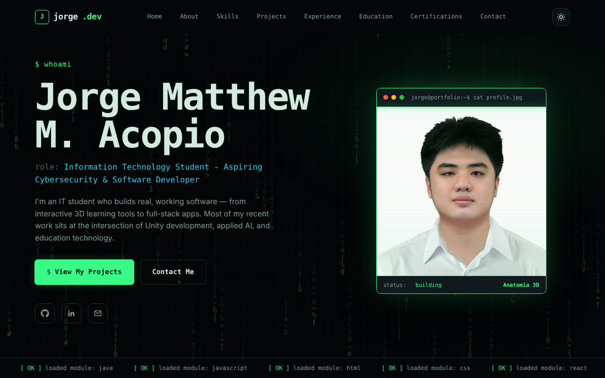

# Jorge.dev — Personal Developer Portfolio

[](https://portfolio-xi-lovat-39.vercel.app)


The portfolio of **Jorge Matthew M. Acopio**, an Information Technology student aiming for a career in cybersecurity and software development. It is a single-page static website with a terminal-inspired design, built with plain HTML, CSS and JavaScript and no framework or build step.

**Live site:** https://portfolio-xi-lovat-39.vercel.app



## Features

- **Matrix-style intro** — a short, skippable code-rain intro (button, `Esc` or `Enter`). Disabled for visitors who prefer reduced motion.
- **Terminal theme** — dark "terminal" look with a light "paper terminal" alternative, switched with the theme toggle.
- **Hero section** — typed `$ whoami` prompt, typing effect for the role, a terminal-window profile photo and a scrolling ticker built from the skills list.
- **Skills** — grouped skill cards with level indicators (advanced, intermediate, familiar).
- **Projects** — seven project cards with filters (All, Mobile, Web, Desktop, Academic, Personal). The All view shows the first four; **See More / Show Less** reveals the rest.
- **Experience and education** — timelines for the capstone work, independent projects and degrees.
- **Certifications** — six certificate cards that open an image viewer (close with the X button, a click outside, or `Esc`).
- **Resume** — download or view the PDF resume.
- **Contact form** — client-side validation and a honeypot field, delivering messages to email through [Web3Forms](https://web3forms.com) with success and error messages.
- **Responsive and accessible** — layouts for desktop, tablet and phone, keyboard focus outlines, and a reduced-motion mode.

## Tech stack

| Area | Technology |
| --- | --- |
| Structure | HTML5 |
| Styling | CSS3 with custom properties (design tokens), Grid, media queries |
| Interactivity | Vanilla JavaScript, Canvas API, IntersectionObserver, Fetch API |
| Fonts | JetBrains Mono, Inter, Space Grotesk (Google Fonts) |
| Contact form | Web3Forms |
| Hosting | Vercel |

## Project structure

```
Portfolio/
├── index.html          # Page structure and content
├── styles.css          # Base styles, design tokens, layout, components
├── styles-cyber.css    # Terminal theme layered over the base styles (plus intro and project-image rules)
├── script.js           # Theme toggle, menu, scroll reveal, project filter / See More, contact form, certificate viewer
├── cyber.js            # Code-rain background, terminal photo frame, typed hero text, module ticker
├── intro.js            # Skippable Matrix-style intro
├── resume.pdf          # Downloadable resume
├── favicon.svg         # Site icon
├── images/             # Profile photo, project images and logos
└── certs/              # Certificate images shown in the viewer
```

## Run locally

No installation or build step is needed.

```bash
git clone https://github.com/JMacopio/Portfolio.git
cd Portfolio
```

Open `index.html` in a browser. For a local server (optional):

```bash
python3 -m http.server 8000
# then visit http://localhost:8000
```

## Customizing

**Add or edit a project** — copy an existing `.project-card` block inside `#projectGrid` in `index.html`. The `data-cat` attribute controls which filters it appears under (`mobile`, `web`, `desktop`, `academic`, `personal`), for example `data-cat="web personal"`. Project images and logos go in `images/` and use `` so they fit the card (add the `cover` class for full-width screenshots).

**Add a certificate** — add a `.cert-card` in `#certifications` and point its button's `data-cert-img` at the image in `certs/`, with a matching `data-cert-title`.

**Change colors and fonts** — the theme variables live in `styles-cyber.css` (`--accent`, `--bg`, `--text`, and so on, with separate values for `html[data-theme="dark"]` and `html[data-theme="light"]`). Base values are in `styles.css`.

**Change the intro text** — edit the `lines` list at the top of `intro.js`. To remove the intro, delete its `<script>` tag, the `#intro` block and the small inline script in `index.html`.

**Contact form** — create a free access key at [web3forms.com](https://web3forms.com) and set it as the `value` of the hidden `access_key` input inside the `#contactForm` in `index.html`. The key is visible in the page source by design of the service, so in the Web3Forms dashboard restrict it to your site's domain and keep spam protection on.

**Resume** — replace `resume.pdf` with your updated file (keep the same filename).

## Deployment

The site is plain static files, so it can be hosted anywhere. It is currently deployed on [Vercel](https://vercel.com): import the repository and deploy with no build command and the project root as the output directory.

## Notes

- The theme choice is not remembered between visits.
- The contact form needs an internet connection to reach Web3Forms.

## License

All rights reserved. This repository is for personal portfolio purposes; please contact the author for permission to reuse the content, photos or certificates.

## Author

**Jorge Matthew M. Acopio** — [GitHub](https://github.com/JMacopio) · [LinkedIn](https://www.linkedin.com/in/jorge-matthew-acopio-73659722b) · acopiojorgematthew@gmail.com
